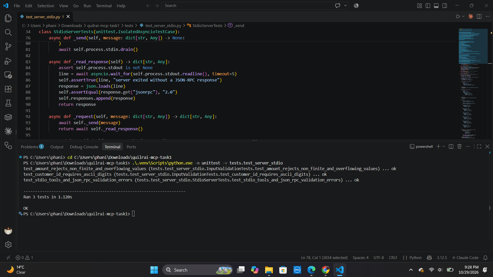
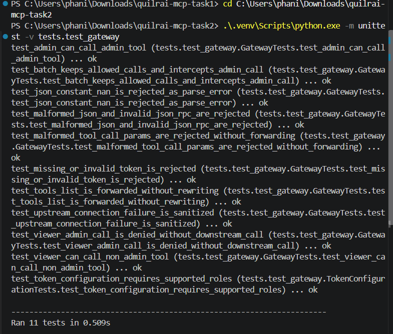
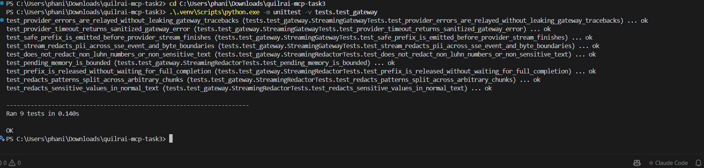
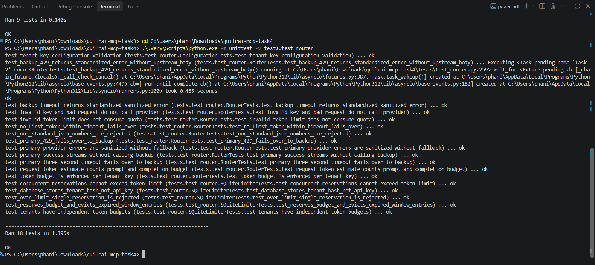

# QuilrAI AI Field Developer / Solutions Engineer Assessment

This repository contains my implementations of the four practical gateway and integration tasks. Each task is kept in its own folder, with setup instructions and tests:

| Task | What it demonstrates | Implementation |
|---|---|---|
| 1. MCP server | Strict tool validation and stdio transport | [task1/](./task1/) |
| 2. MCP security gateway | Bearer-token roles, tool filtering, JSON-RPC proxying | [task2/](./task2/) |
| 3. Streaming guardrail | Incremental PII redaction for SSE output | [task3/](./task3/) |
| 4. Model fallback router | SQLite token quotas, asynchronous failover, safe errors | [task4/](./task4/) |

The answers below summarize the design decisions and behavior implemented in the code. Each folder's README has more detailed configuration and run instructions.

## Task 1 — Custom MCP server with strict validation

**Assessment question:** How do you expose `get_customer_record` and `trigger_refund` through stdio MCP, validate their inputs strictly, and keep diagnostic output away from the protocol stream?

**Answer:** The Python server uses the official MCP SDK and Pydantic. It exposes both requested tools over the SDK's stdio transport. Customer IDs are interpreted as `CUST-` followed by exactly five ASCII digits. Refund amounts must be finite JSON numbers greater than zero, and reasons must be at least 10 characters; unexpected fields are rejected.

Invalid tool arguments return the standard JSON-RPC `Invalid params` code (`-32602`). A low-level SDK request handler is used for tool calls so validation failures become protocol errors rather than successful-shaped tool results. The example customer record is demo data, and refunds are simulations only. Application logging is directed to stderr; stdout is reserved for MCP messages.

**Verification:** Three tests cover both input models and a real stdio subprocess exchange: initialization, tool listing, successful calls, invalid inputs, and JSON-RPC output.



## Task 2 — MCP security gateway proxy

**Assessment question:** How do you proxy MCP JSON-RPC over HTTP, identify the caller's role from a Bearer token, and prevent viewers from invoking tools named `admin_*`?

**Answer:** The FastAPI gateway maps configured opaque tokens to `admin` or `viewer` roles. It forwards `tools/list` requests and ordinary tool calls. For `tools/call`, it inspects `params.name`; an `admin_` tool called by a viewer is stopped at the gateway and receives JSON-RPC `-32001`, without being sent downstream. The included mock MCP server supports a local demonstration without external credentials.

The proxy preserves the wire body for single requests, filters authorization and hop-by-hop headers, checks JSON-RPC request envelopes, and handles mixed batches by forwarding only allowed entries. Unknown credentials are rejected. Upstream connection and timeout failures use sanitized gateway errors.

**Verification:** Eleven tests exercise admin/viewer access, transparent forwarding, no-forwarding on denial, malformed requests, mixed batches, and sanitized failures.



## Task 3 — Streaming LLM PII-redaction guardrail

**Assessment question:** How can a gateway redact email addresses, SSNs, and payment-card numbers in a live model stream without buffering the complete response?

**Answer:** The FastAPI endpoint accepts OpenAI-compatible chat-completion requests and processes successful SSE streams event by event. It rewrites text in `choices[].delta.content`, maintaining a separate redactor for each choice. A bounded suffix is held back when it could be the start of a sensitive value; safe text is emitted while the provider is still streaming. This allows patterns split across chunks to be detected without retaining the entire completion.

The guardrail recognizes common email and US SSN patterns and redacts card-number candidates only if they pass the Luhn check. Event buffering has a size limit. Mock-provider tests do not require a live model account or API key.

**Verification:** Nine tests cover PII detection, split-chunk redaction, bounded buffering, early safe-text delivery, and provider error handling.



## Task 4 — Token-aware rate limiter and model fallback

**Assessment question:** How do you enforce a per-tenant rolling token limit, fail over when the primary is rate-limited or times out after three seconds, and return errors without exposing upstream details?

**Answer:** The router authenticates tenant API keys and estimates request tokens with `tiktoken`, reserving the prompt estimate plus the requested maximum completion tokens. A SQLite ledger stores reservations under a SHA-256 tenant identifier. A `BEGIN IMMEDIATE` transaction makes expiry, quota checking, and reservation atomic under concurrent requests. The default budget is 50,000 tokens per tenant per rolling 60-second window.

An HTTP 429 from the primary, or failure to receive response headers or the first response bytes within three seconds, triggers one attempt against the configured backup. Successful responses are streamed. Upstream error bodies are replaced with a consistent gateway error containing a safe code, message, and request ID. Once response bytes have already been sent to a client, a later mid-stream failure cannot be transparently retried.

**Verification:** Eighteen tests cover quota accounting and expiry, concurrent admission, tenant isolation, SQLite persistence, primary success, 429/timeout fallback, and sanitized provider errors.



## Run the tests

Each task has its own dependencies. From the repository root, install each task separately and run its corresponding suite:

```powershell
cd task1
py -3.12 -m venv .venv
.\.venv\Scripts\Activate.ps1
python -m pip install -e .
python -m unittest -v tests.test_server_stdio
```

For the other folders, use the same setup commands and these test modules:

| Folder | Test command |
|---|---|
| `task2` | `python -m unittest -v tests.test_gateway` |
| `task3` | `python -m unittest -v tests.test_gateway` |
| `task4` | `python -m unittest -v tests.test_router` |

The four suites currently contain **41 passing tests** in total. Tasks 2–4 use mock upstream services in tests. No production API credentials are included in this repository.

## Scope and limitations

- Task 1 returns deterministic demo data and simulates refunds; it does not connect to a real customer database or payment service.
- Task 2's example tokens and downstream MCP implementation are for local testing, not production identity management.
- Task 3 covers common pattern-based PII classes. It is not a general-purpose data-loss-prevention classifier.
- Task 4 conservatively reserves the requested output-token maximum. Reserved tokens are counted even if a provider call later fails or uses fewer tokens.
- No live provider credentials are needed to run the automated tests.
